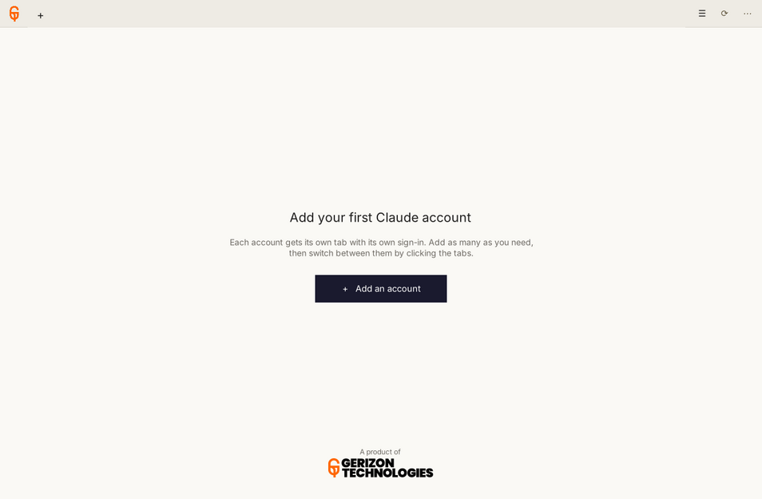

# Claude Multi-Account Launcher

**A product of Gerizon Technologies**

Use several Claude accounts on one Windows PC, each in its own tab. Every tab keeps its own sign-in, so switching accounts is just clicking a tab. You don't need to sign out and back in, juggle browser profiles or keep extra windows open.

> Independent open-source tool. Not made by, affiliated with, or endorsed by Anthropic. Claude is a trademark of Anthropic, PBC.

## Features

- **One tab per account.** Add as many as you need, any time.
- **Separate sign-ins.** Each account has its own private browser data on your PC.
- **Remembers everything.** Tabs and sign-ins are still there after you close the app or restart your PC.
- **Quick switching.** Click a tab, or press Ctrl+1 to Ctrl+9 or Ctrl+Tab. The ☰ menu lists every account.
- **Tab options.** Rename, change colour, move left or right, reload, start a new chat, or delete the account from the app.
- **Safe link handling.** Links inside chats open in your normal browser. Sign-in pop-ups stay inside the right account.
- **Lightweight.** No installer, no admin rights, no background service and no registry changes.

## Requirements

- Windows 10 or 11 (x64, x86 or ARM64)
- .NET Framework 4.6.2 or later (built into Windows 10 and 11)
- Microsoft Edge WebView2 Runtime (built into Windows 11 and most Windows 10 PCs). If it's missing, the app offers Microsoft's download page.

### Mac (preview)

A Mac version is available as a preview for macOS 12 or later, on Apple chip and Intel Macs. See [docs/MAC.md](docs/MAC.md) for download, first-open and test steps. Its source is in the `electron` folder, and GitHub builds and tests it automatically on a Mac.

## Install

1. Download the latest release zip and unzip the **whole folder** somewhere it will stay, such as Documents.
2. Run `ClaudeMultiAccountLauncher.exe`. It adds itself to the Start menu.

## Using it

| To | Do this |
|---|---|
| Add an account | Click **+** (or press Ctrl+T), name the tab, then sign in inside it. |
| Sign in with an emailed link | Don't click the link. Right-click it, choose **Copy link**, then click **Paste sign-in link** in the tab. |
| Switch accounts | Click a tab, or press Ctrl+1 to Ctrl+9 or Ctrl+Tab. |
| Delete an account | Right-click its tab and choose **Delete account**. This signs it out on this PC and deletes its local data. It doesn't delete the Claude account itself. |

### Good to know

- This shows the **web version** of Claude. Desktop-only features such as Cowork aren't available in tabs.
- Google sign-in often refuses to work inside apps. Use email sign-in instead.
- Browser extensions aren't supported. See [docs/FAQ.md](docs/FAQ.md).

## Where data is kept

| What | Where |
|---|---|
| Tab names, order and window size | `%LOCALAPPDATA%\Gerizon\ClaudeMultiAccountLauncher\tabs.json` |
| Browser data (sign-in) for each account | `%LOCALAPPDATA%\Gerizon\ClaudeMultiAccountLauncher\Tabs\acct-xxxxxx\` |

Nothing is sent anywhere except claude.ai and any sign-in pages it opens.

## Uninstall

Delete each account from the app, then delete the app folder and the **Claude Multi-Account Launcher** Start menu shortcut.

## Build from source

The app is a single C# file (WinForms on .NET Framework 4.x) using the Microsoft Edge WebView2 SDK 1.0.3856.49.

**Linux or macOS (Mono):** put the WebView2 SDK DLLs in `lib/` (see `build.sh`), then run `./build.sh`.

**Windows:** compile `src/Program.cs` with the C# compiler from .NET Framework or Visual Studio, referencing `System.Windows.Forms`, `System.Drawing`, `System.Runtime.Serialization`, `System.Core` and the two WebView2 DLLs. Embed `assets/gerizon-mark.png` and `assets/gerizon-logo-64.png` as resources with those names. Use `src/app.rc` for the icon, version information and manifest.

Code signing is covered in [docs/CODE_SIGNING.md](docs/CODE_SIGNING.md).

## License

[MIT](LICENSE) © 2026 Gerizon Information Technology Solutions. Logos and trademarks are covered in [NOTICE.md](NOTICE.md).
